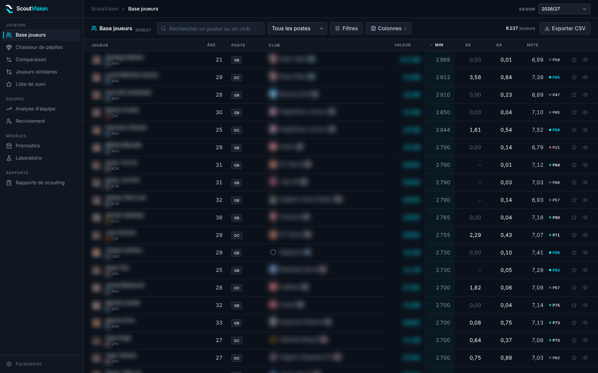
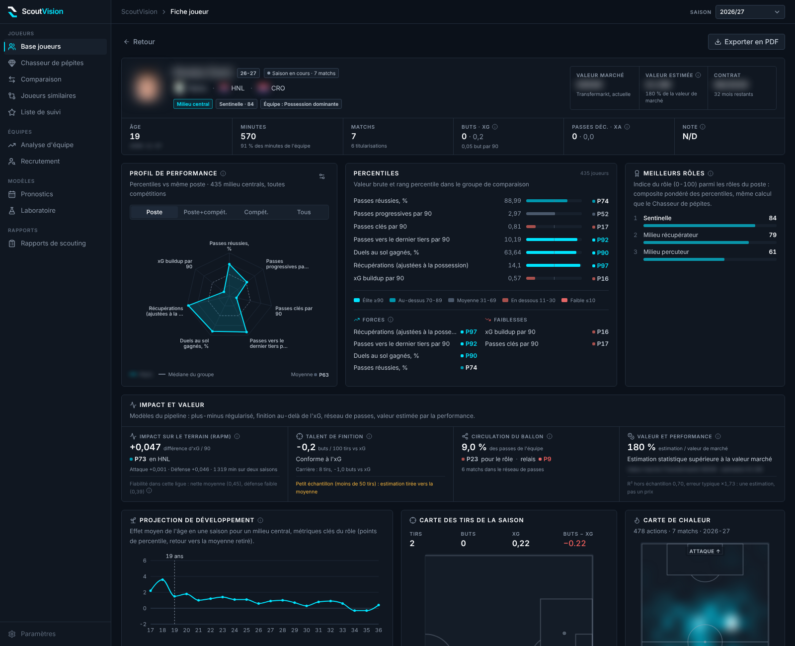
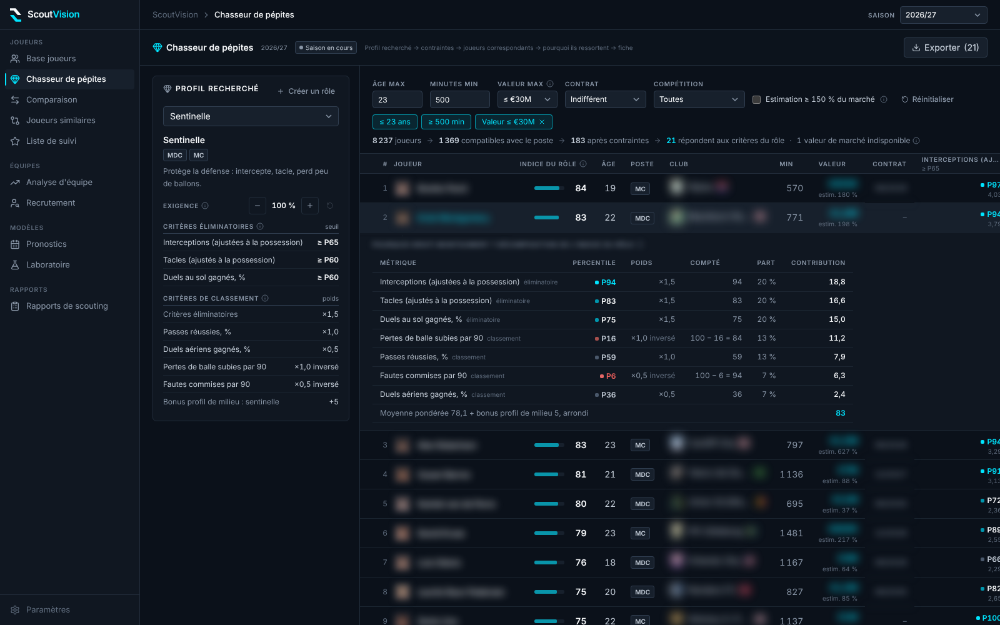

<div align="center">

<p align="center">
  
</p>

**Professional Football Scouting Platform**

A modern, data-driven scouting application for football analytics with AI-powered player analysis.


</div>

## ✨ Features

- 📊 **Player Database** - 35 competitions, seasons 2021-22 → today (PitchAPI), with advanced filtering
- 🔍 **Player Comparison** - Compare up to 4 players side-by-side with radar charts
- 🎯 **Similarity Finder** - Find statistically similar players using advanced algorithms
- 💎 **Gem Hunter (Prospects)** - Scout prospects with 27 percentile-based role presets
- ⚽ **Team Analysis** - Squad depth, tactical profiles, shot maps and recruitment
- 🧩 **Data-driven recruitment** - Team needs by position, squad profile, and player suggestions projected into the team (league level, team context, adaptation), with complementarity and a value-for-money frontier
- 📝 **AI Scout Reports** - Scouting reports written by Gemini through a server endpoint (the API key stays on the server)
- 🌙 **Analyst UI** - Dense dark design system built from the ScoutVision logo (tokens, percentile tiers, colour-blind-checked chart palette)
- 📈 **Impact & value** - RAPM (regularized plus-minus), finishing skill, pass-network role, performance-based value vs Transfermarkt
- 🌱 **Development** - Age curves by role and one-year percentile projection (regression to the mean separated from age)
- 🧭 **Playing styles** - Team styles (PCA + k-means) and style map per competition
- 🗓️ **Forecasts** - Win / draw / loss probabilities of upcoming matches
- 🧪 **Laboratory** - New ideas tested on match-by-match data (coaches, momentum, goal value, pass chemistry, referees, transfers), each with a verdict

## 📸 Screenshots

Taken from the app with real data (season 2026-27). The PitchAPI data is private: player and
club names, photos, logos, market values, contracts and birth dates are blurred.

**Player database** — dense sortable table, configurable stat columns, percentiles



**Player card** — key figures, radar linked to percentiles, best roles, impact and value models,
development projection, shot map and heatmap



**Gem Hunter** — role profile and criteria, constraints, selection funnel, role index and its
breakdown (“why this player?”)



## 🚀 Getting Started

### Prerequisites

- Node.js 18+
- npm or yarn
- Gemini API Key (for AI reports)

### Installation

1. **Clone the repository**
   ```bash
   git clone https://github.com/YOUR_USERNAME/scoutvision-ai.git
   cd scoutvision-ai
   ```

2. **Install dependencies**
   ```bash
   npm install
   ```

3. **Set up environment variables** (server side only)

   Create a `.env.local` file (git-ignored):
   ```env
   GEMINI_API_KEY=your_gemini_api_key_here
   ```

   The key is read by the `/api/scout-report` endpoint only and is never sent to the
   browser (see [AI scout reports](#-ai-scout-reports-server-endpoint)). Without it the app
   works, only the report generation answers "unavailable".

4. **Get the data** (PitchAPI, 2021-22 → current season)

   The data comes from the private repo
   [`Cordierarn/PitchApi-big-5`](https://github.com/Cordierarn/PitchApi-big-5)
   (35 competitions, updated twice a week). The `gh` CLI must be logged in with
   read access to that repo (`gh auth login`).

   ```bash
   npm run data:pull        # download the data prepared by CI (~60 MB), no Python needed
   ```

   Or build it yourself from the PitchAPI releases:

   ```bash
   pip install -r scripts/requirements.txt
   npm run data:prepare                                     # all seasons and competitions
   python3 scripts/prepare_data.py --seasons 2026-27        # current season only
   python3 scripts/prepare_data.py --no-market-values               # without Transfermarkt
   ```

   Archives are cached in `.cache/pitchapi/`; the output goes to `public/data/`
   (both are git-ignored: the source data is private).

5. **Run the development server**
   ```bash
   npm run dev
   ```

## 🎨 Design system

The interface follows the logo: background `#0B111A`, ink `#F8FAFC`, accent cyan `#00E5FF`, short angular radii.

| Where | What |
|---|---|
| `styles/index.css` | colour tokens (CSS variables), base styles and primitives: `sv-panel`, `sv-label`, `sv-input`, `sv-select`, `sv-btn-*`, `sv-chip`, `sv-tag`, `sv-seg`, `sv-tabs`, `sv-table`, `sv-tooltip`, `sv-menu` |
| `tailwind.config.js` | token names for Tailwind: `canvas`, `surface`, `raised`, `overlay`, `line`, `ink`/`ink-2..4`, `accent`, `pos`, `neg`, `warn` |
| `components/ui` | `PageHeader`, `Panel`, `Stat`, `PercentileBar`, `PercentileRow`, `PercentileValue`, `PercentileLegend`, `LegendItem`, `Delta`, `EmptyState`, `PolarTick` |
| `theme/charts.ts` | chart identity: series order (cyan, orange, violet, yellow; checked for colour blindness on the panel surface), context grey, diverging pair, cyan sequential ramp, reserved status colours, Recharts axis/grid/tooltip props |
| `theme/percentile.ts` | percentile tiers: elite ≥ 90, above 70-89, average 31-69, below 11-30, weak ≤ 10 |

Colour never carries meaning alone: percentiles show their value (P92), verdicts and needs keep their icon and label.

## 📁 Data Format

`scripts/prepare_data.py` writes compact column/row JSON files, loaded on demand:

| File | Content |
|---|---|
| `public/data/index.json` | available seasons and competitions |
| `public/data/players/<season>.json` | one row per player × team × competition (PitchAPI `player_season`) |
| `public/data/teams/<season>.json` | team metrics (`team_season`): xG, PPDA, possession, field tilt… |
| `public/data/shots/<season>/<COMP>.json` | shots of one competition (`shot`), loaded when a team or player is opened |
| `public/data/heatmaps/<season>/<COMP>.json` | per-player season heatmaps (`heatmap`, 16 × 12 grid of actions), loaded when a player is opened |
| `public/data/lineups/<season>/<COMP>.json` | formations actually used and, per slot, the players who started there most (`lineup`) |
| `public/data/models/age_curves.json` | per role and metric: regression-to-the-mean coefficient and age effect (percentile points per season) |
| `public/data/models/transfer.json` | transfer model: league levels, per-metric coefficients (league gap, team context, adaptation cost), out-of-sample validation |
| `public/data/market.json` | current Transfermarkt value, contract end and estimated value of every player, used by recruitment whatever the season analysed |
| `public/data/forecast.json` | upcoming matches with 1-N-2 probabilities and expected xG (PitchAPI `forecast` report) |

- An app season is a European season (`2024-25`). Calendar-year competitions
  (Norway, Sweden…) are filed under the season that starts the same year (`2024` → `2024-25`).
- Per-90 metrics are PitchAPI's **shrunk** per-90 values. Each metric `X` has a
  percentile `X pct` (0-100) among players of the same role (GK, CB, FB, WB, DM,
  CM, AM, W, ST) and the same competition level. Role scores, the Gem Hunter
  thresholds and the radars all use these percentiles.
- Only players with at least 40% of their team's minutes are included
  (PitchAPI `player_season` threshold).
- Transfermarkt (`market_value.parquet`, read from the `scoutvision-data` release):
  birth date, height and foot are used for every season (missing Wikidata ages are
  computed at season start: 1 July, or 1 January for calendar-year seasons);
  market value and contract end are a current snapshot, shown for the current
  season only. `--no-market-values` skips it.

## 🔬 Advanced indicators (from the research synthesis)

Built by `scripts/prepare_data.py` (models in `scripts/models.py`, numpy only) or taken
from the PitchApi-big-5 analyses in `global.tar/reports/`:

| Indicator | Where | Method |
|---|---|---|
| **RAPM** (attack, defence, net) | player card, report | regularized plus-minus in xG/90 from the pipeline (two-season window, European leagues); percentile within the league; league reliability shown, defence is often unreliable |
| **Finishing skill** | player card, report | pipeline player effect, shrunk: goals above xG per 100 shots over the career (not raw goals − xG, too noisy) |
| **Pass share / relay role** | player card | pass network until the first substitution: share of the team's passes, mean betweenness; percentiles by role and level |
| **Team playing style** | tactics tab, player card | k-means (6 styles) on possession, territory, PPDA, line height, directness, build-up, fitted on all team-seasons; map on the first two PCA axes (87% of variance) |
| **Development** | player card, report | one-season change of role percentiles: regression to the mean (β ≈ −0.5) separated from the age effect; one-year projection |
| **Estimated value** | player card, Gem Hunter | ridge on log10(Transfermarkt value), out-of-fold predictions (R² ≈ 0.70, typical error ×1.7); current season only |
| **Forecasts** | Forecasts page | leagues: pipeline `forecast` model (xG attack/defence strengths, home advantage). European cups (UCL, UEL, UECL): joint all-competition Poisson model in `scripts/models.py` (league level + team deviation, linked through cup matches, Dixon-Coles); out-of-sample RPS 0.209 vs 0.236 for 1-X-2 frequencies on 286 past cup matches |
| **Season outlook & match leverage** | Forecasts page | 20,000 simulations of the remaining fixtures (pipeline 1-X-2 probabilities): P(title), P(top 4), P(bottom 3); leverage of a match = change in P(objective) between a win and a loss (Serie A study, 2026) |
| **Transfer projection** | Team Analysis > Recruitment | percentile expected next season at the recruiting club = age-curve projection + λ<sub>metric</sub> × (level of the league left − level of the league joined) + τ<sub>metric</sub> × change in field tilt + adaptation cost (league change or club change). One level per league shared by all metrics (alternating least squares, shrunk towards the PitchAPI tier mean), fitted on consecutive seasons at the same role, weighted by minutes. PitchAPI percentiles are computed per tier, so a level is a translation, not a strength ranking. Validation on the last closed season, left out of the fit (age curves included): see below |
| **Team needs** | Team Analysis > Recruitment | real starting eleven of the most used formation (maximum-weight assignment of the lineup slots); each starter in his best role, projected one season ahead and ranked among the league players eligible for that role; contract end, expected decline and lack of cover are flagged |
| **Squad profile** | Team Analysis > Recruitment | minutes-weighted mean of the players' role percentiles on 9 dimensions (finishing, creation, progression, dribbling, ball security, ground duels, aerial play, recovery, goalkeeping), ranked among the league's teams |
| **Suggestions** | Team Analysis > Recruitment | role index recomputed on projected percentiles, compared with the starter projected in the same role; complementarity: the line partner's weak metrics (below the 35th percentile) count in the index; filters on age, Transfermarkt value, minutes, contract, leagues; value-for-money frontier (no other candidate is both better and cheaper) |
| **Model vs market** | Forecasts page | odds from football-data.co.uk (27 competitions): pipeline backtest vs margin-free closing odds (power de-vig) — RPS, log-loss, model weight in a logarithmic pool, simulated value bets judged by closing line value. Oct. 2026: RPS 0.2102 vs 0.2034, weight 0.00, CLV −10.5 % on 1,702 bets: no edge |

**Recruitment validation** (Oct. 2026, test season 2025-26, absent from the fit, 405 league
changes, role presets of the Oct. 2026 calibration): mean absolute error of the role index 12.18
points with the transfer model, 13.88 with the age curves alone, 16.79 when the current index is
kept; rank correlation with the index actually reached 0.525 vs 0.347; bias of players moving up a
level +1.33 points vs +9.81 (moving down: −0.18 vs −6.99). Per metric (does not depend on the
presets): 21.7 vs 26.1 percentile points, bias moving up +0.0 vs +6.7. With the previous presets:
12.25 / 13.96 / 16.88, rank 0.529, bias +1.38 / −0.27. Per role the error is uneven (about 8 to 16
points on 37 to 111 movers per role, so differences under about 1 point are noise); it rose for
*Créateur excentré* (15.2 → 16.2) and *Faux neuf* (12.9 → 13.5), now evaluated on wingers and
strikers only (52 and 54 movers instead of 82 and 84), and for *Gardien libéro* (11.7 → 12.3,
42 goalkeepers); it fell for *Gardien relanceur* (15.9 → 14.6) and *Neuf et demi* (15.5 → 14.6).
A role index still moves by about 12 points from one season to the next: suggestions are a
shortlist for video and scouting, not a verdict. Recomputed by every `prepare_data.py` run
(`models/transfer.json`, shown in the app under *Méthode et fiabilité*).

Not shown on purpose: substitution and coach rankings. The pipeline's own study
(`docs/analyses/remplacements.md`) finds them not reproducible (split-half correlation ≈ 0).

RAPM, finishing and forecasts come from `python -m pitchapi_big5 rapm`, `finishing`
and `forecast`, which the weekly PitchAPI workflow does not run: run them (or add
them to that workflow, before `publish-data`) to keep these indicators current.

Models are fitted on the seasons being prepared: run `prepare_data.py` without
`--seasons` for the full fit (age curves and styles use every season).

## 🧪 Laboratory

`scripts/prepare_lab.py` (run after `prepare_data.py`, or `npm run data:lab`) reads the match-by-match
tables of every competition (events, lineups with the coach, momentum, pass networks, shots) and runs
the experiments of `scripts/lab.py`. Each one answers a question with a verdict (validated, partial,
debunked, measured); forecasts are always validated on matches or seasons left out of the fit. Results
go to `public/data/lab/` and to the *Laboratoire* page; every number is recomputed at each run.

| Experiment | Method | Result (Oct. 2026) |
|---|---|---|
| **New-coach bounce** | 10 league matches before / after a mid-season change; post = a + b·pre + c·older level + effect·change; controls = windows without any change (regression to the mean); event study with matched controls | debunked: +0.21 pt/match after a change, but regression to the mean predicts it; own effect −0.004 xGD/match, 95% CI [−0.05; +0.05], 325 changes (an assistant on the bench during a suspension is not a change) |
| **Coach DNA** | style of a coach's new club = a + b·club's previous style + c·coach's style at his previous club, 6 dimensions (possession, field tilt, pressing, build-up, directness, height) | validated: c = 0.21 to 0.34, all CIs above 0, 336 arrivals of 235 coaches; app: coach explorer and arrival simulator |
| **Do results follow the coach?** | performance beyond the team's previous level, correlation between two successive clubs | debunked: r = 0.12, CI [−0.01; 0.24] |
| **Style matchups** | 36 style × style interactions added to a team-strength model of log xG, 5-fold cross-validation by match | debunked: out-of-sample error slightly worse |
| **Fatigue** | xGD beyond strengths and venue with ≤ 3 rest days against an opponent with 6+ | debunked: −0.035, CI [−0.08; +0.01] (domestic cups missing) |
| **Momentum** | does minute-by-minute pressure predict the next goal beyond score, strengths and the last 5 minutes' xG? logistic, validated on the last closed season | validated (modest): better than recent xG; 12 % → 15 % chance of a home goal within 10 min from the weakest to the strongest momentum, without any shot |
| **Goal value** | in-game win probability (Poisson on the remaining share of goals, real goal-time distribution), value = expected points gained | a goal giving the lead is worth 0.93 pt, a 3rd goal when 2 up 0.05; points per goal r = 0.31 season to season; app: leaderboard |
| **The elevator** | players outside the Big 5: transfer to a clearly stronger league next season (logistic: role index, age, minutes, origin league, club strength) | validated: AUC 0.77 out of sample, 36 moves among the top 100 vs 8.6 % on average; app: ranking and live check |
| **Statistical twins** | PECOTA-style: next-season index from the 25 most similar players at the same age | partial: on par with the age curves for under-23s, not better overall |
| **Pass chemistry** | passes of a duo vs volume × positional expectation; odd vs even matches | validated: reliability r = 0.53 over 65,000 duos; app: duos per team |
| **Referees** | cards vs league average, odd vs even matches; penalties; home bias | cards validated (r = 0.58); penalties and home bias debunked; app: shrunk strictness table |
| **Squad clock** | minutes-weighted age effect of the squad vs next-season xGD | validated: +0.041 xGD/match per point, CI [0.012; 0.072] |
| **Set pieces** | share of xG from set pieces, season to season | validated: r = 0.42 |
| **Game management, late strength** | xG share when leading / trailing, xGD after 75', season to season | debunked: r ≤ 0.16 |
| **Luck** | points − xPts between season halves | measured: r = 0.16; first-half xGD predicts second-half points better than points (0.65 vs 0.60) |
| **Red cards** | xG per 90 before / after the first red card | measured: the opponent's xG doubles (1.29 → 2.59) |
| **Availability** | share of the team's matchday squads, season to season | partial: r = 0.19 |

## 🔄 Automatic data updates

`.github/workflows/update-data.yml` runs every Monday and Friday at 10:30 UTC
(after the PitchApi-big-5 update at 08:00) and on demand (*Actions* > *Run workflow*).
It runs `scripts/prepare_data.py` then `scripts/prepare_lab.py` and uploads `scoutvision-data.tar.gz` to the
**private** release `scoutvision-data` of PitchApi-big-5. Nothing is committed
to this public repo, and no artifact or cache holds the data.

**One-time setup**

1. Create a fine-grained personal access token: repository access *only*
   `Cordierarn/PitchApi-big-5`, permission *Contents: Read and write*.
2. Add it to this repo: *Settings* > *Secrets and variables* > *Actions* >
   *New repository secret*, name `PITCHAPI_DATA_TOKEN`.
3. Market values: `market_value.parquet` (output of
   `python -m pitchapi_big5 market-values`) lives in the `scoutvision-data`
   release; `prepare_data.py` reads it automatically. To refresh it:
   `gh release upload scoutvision-data data/external/transfermarkt/market_value.parquet --clobber`
   (from PitchApi-big-5).

**Optional: trigger right after the PitchAPI update.** Add this last step to
the PitchApi-big-5 workflow (with a secret `SCOUTVISION_DISPATCH_TOKEN`: a
fine-grained PAT on `Cordierarn/scoutvision-ai` with *Contents: Read and write*):

```yaml
      - name: Notify ScoutVision
        run: gh api repos/Cordierarn/scoutvision-ai/dispatches -f event_type=pitchapi-data-updated
        env:
          GH_TOKEN: ${{ secrets.SCOUTVISION_DISPATCH_TOKEN }}
```

## 🤖 AI scout reports (server endpoint)

The browser never calls Gemini. The "Générer" button of the player profile posts the player
row and the computed indicators to `POST /api/scout-report`; the server validates the input,
builds the prompt and calls Gemini with `GEMINI_API_KEY`.

```
Frontend (PlayerCard) → POST /api/scout-report (server/) → Gemini API
```

| | |
|---|---|
| Variable | `GEMINI_API_KEY`, server environment only (`.env.local` locally). Never prefix it with `VITE_`: the build stops if a `VITE_` variable looks like a secret |
| Code | `server/scoutReport.ts` (validation, prompt, handler), `server/scoutReportPlugin.ts` (Node middleware, Vite plugin), `services/scoutReportService.ts` (client) |
| Limits | JSON only, body ≤ 128 KB (413 above), 20 reports per 10 min per client (429), 60 s Gemini timeout |
| Errors | 400 invalid input, 503 key not configured, 502 Gemini failure; messages are generic, the key is masked in server logs |

**Deployment.** The repository has no hosting configuration: the app is a Vite single-page app
whose server already proxies `/cdn` (images). The endpoint is mounted on the same Vite servers:

- `npm run dev` (development) and `npm run build && npm run preview` (production build) serve
  `/api/scout-report` and `/cdn` with no extra service. This is the supported way to run the app.
- On a static host (plain `dist/` on a CDN), the endpoint does not exist: the report shows
  "endpoint absent", the rest of the app works. To enable it, run `scoutReportMiddleware`
  (`server/scoutReportPlugin.ts`, signature `(req, res, next)`) on any Node server (http,
  Express, Connect) next to `dist/`, or wrap `handleScoutReport` (`server/scoutReport.ts`) in the
  serverless function of your platform, and set `GEMINI_API_KEY` in its environment. The same
  host must rewrite `/cdn/*` (see below).

## 🖼️ Images

Player photos and club logos come from the PitchAPI CDN, flags from
[flagcdn](https://flagcdn.com). The CDN does not send CORS headers, so images
are served through the `/cdn` proxy of the Vite server (`vite.config.ts`),
which lets the PDF export include them. A production host must apply the same
rewrite: `/cdn/*` → `https://cdn.pitchapi.dev/*`.

## 🎯 Tactical Roles (Gem Hunter, squad depth, recruitment)

27 role presets across 9 categories, defined in `utils/rolePresets.json` (read by the app and
by `scripts/models.py`, which validates the role index of the transfer model). Each role has
eliminatory criteria (minimum role percentile, weight 1.5 in the index) and ranking criteria
(weights, negative = "lower is better"):

| Category | Roles |
|----------|-------|
| Goalkeeper | Gardien sur sa ligne, Gardien libéro, Gardien relanceur |
| Centre back | Défenseur relanceur, Stoppeur, Défenseur d'anticipation, Défenseur porteur |
| Full back / wing back | Latéral offensif, Latéral défensif, Latéral intérieur |
| Defensive midfield | Sentinelle, Regista, Milieu récupérateur |
| Central midfield | Milieu box-to-box, Milieu percuteur, Mezzala |
| Attacking midfield | Numéro 10, Neuf et demi |
| Winger | Ailier de débordement, Attaquant intérieur, Créateur excentré |
| Striker | Renard des surfaces, Pivot, Faux neuf, Attaquant de profondeur, Attaquant presseur |
| Specialist | Créateur sur coups de pied arrêtés |

A low "floor" criterion (e.g. *Neuf et demi*: key passes ≥ P40) is eliminatory but carries its
own small ranking weight (0.5), so it does not count 1.5 like a defining criterion. The player
card (best roles, header), the Gem Hunter, recruitment and the AI report all use these presets and
the same index (`roleIndex`, explained by `roleIndexBreakdown`). The former `ROLE_DEFINITIONS`
(`utils/scoringUtils.ts`) are deprecated and no longer displayed.

**Calibration of Oct. 2026** (audit of the 27 roles on 2025-26 and 2026-27): *Gardien libéro*,
*Gardien relanceur*, *Défenseur porteur*, *Milieu percuteur*, *Numéro 10*, *Neuf et demi*,
*Créateur excentré* (wingers only), *Faux neuf* (strikers only) and *Attaquant presseur* were
recalibrated; *Attaquant de profondeur* and *Créateur sur coups de pied arrêtés* only changed
description (off-ball runs and set pieces are not in the data). Revalidated with the full pipeline
(Oct. 28): the transfer model's coefficients do not depend on the presets and the recruitment
validation above barely moves (index error 12.25 → 12.18, rank 0.529 → 0.525). The published
`scoutvision-data` archive was rebuilt by the data workflow with these presets; its validation is
identical to the local run.

## 🧪 Tests

```bash
npm test               # Vitest: role index, starting eleven, projections, recruitment,
                       # /api/scout-report (validation, size and rate limits, key never returned)
npm run test:data      # Python (unittest): transfer model (parameter recovery on simulated data), lineups, market,
                       # lab experiments (each one must find a simulated effect, or its absence)
```

## 🛠️ Tech Stack

- **Frontend**: React 19, TypeScript
- **Build Tool**: Vite
- **Styling**: Tailwind CSS 3 (compiled with PostCSS), design tokens in `styles/index.css` and `tailwind.config.js`
- **Charts**: Recharts
- **AI**: Google Gemini API, called server side only (`server/`)
- **PDF Export**: jsPDF, html2canvas
- **Data pipeline**: Python (pandas, pyarrow), GitHub Actions

## 📄 License

MIT License - feel free to use this project for your own scouting needs!

## 🙏 Acknowledgments

- Data from [PitchAPI](https://pitchapi.dev), collected by `Cordierarn/PitchApi-big-5`
- Inspired by professional football analytics platforms

---

<div align="center">
Made with ❤️ for football scouts and analysts
</div>
